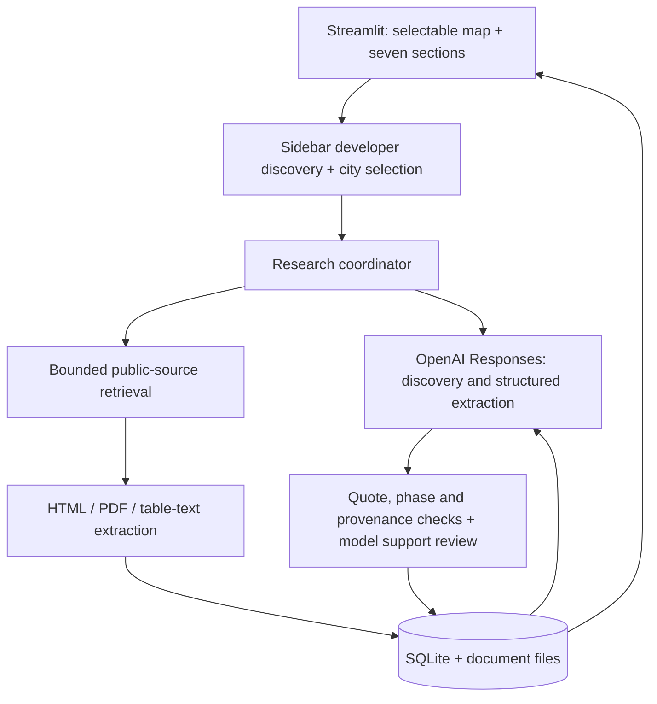

# Grid Atlas · Datacenter site research

A local Streamlit workspace for investigating announced and existing US datacenter projects, covering power, cooling and water, connectivity, reliability, economics, market competition, and land/permitting/community factors. Findings use the full workspace width; the AI chat panel has been removed.

## Run locally

Prerequisites: [uv](https://docs.astral.sh/uv/getting-started/installation/) and internet access for the initial dependency download. Python 3.14 is pinned to match this project's original environment; uv can install it if needed.

From this project directory:

```powershell
uv sync --locked
uv run streamlit run app.py
```

Open http://127.0.0.1:8501. The server binds to localhost, not your LAN. The app opens directly in the **Live workspace**. An OpenAI API key is required for new research. All dependency and environment operations use uv; no separate frontend build is required.

## Connect live research

Copy `.env.example` to `.env`, then edit it locally:

```dotenv
OPENAI_API_KEY=your-own-key
OPENAI_MODEL=gpt-6-astra
```

Restart the app. Environment variables or `.streamlit/secrets.toml` with `OPENAI_API_KEY` are also supported. Do not commit secrets. The model is configured with OPENAI_MODEL in the environment; your account needs access to a model supporting Responses, web search, and structured outputs. The default is based on the official documentation consulted during implementation, not a promise of account availability or pricing.

Live workflow:

1. In the left sidebar, select **Developer name** and click **Find sites**. A bounded search returns up to 20 announced/existing US sites. This is not a complete developer portfolio. Results persist locally per developer; Find sites explicitly runs a new paid discovery.
2. Click a city pin on the US map to start an investigation. If several campuses share that city, choose a campus from the buttons below the map. Sites whose city cannot be matched remain selectable in the site list, without an invented pin.
3. Read all seven research sections. Every requested field is present; unsupported fields say **Details not available.** That means evidence was not retrieved and verified, not that an asset or permit does not exist.
4. Follow the direct reference links beside each finding. Announcements and reporting remain attributed, and market/regional/company information keeps its scope. Generic cost, queue, rack-density or lead-time ranges are never inserted as campus facts.
5. Completed seven-part investigations are reused when selecting a campus again. Ordinary reruns do not repeat paid research. An incomplete, empty, failed or older investigation has an explicit Retry investigation button. Export, refresh, history and saved-investigation controls are absent from the interface.
6. Review the retrieval diagnostics when a report is incomplete. Failed retrieval and unavailable public evidence are distinct; the app reports readable records, blocked publisher domains and rejection reasons.

Recognized sources include registered official developer/operator websites, government/SEC/EIA and ISO/NERC/FERC sources, Uptime Institute, and verified utility/planning publisher domains. Additional permitted specialist sources are CBRE, JLL, Cushman & Wakefield, Data Center Dynamics and PeeringDB. Market reports are restricted to market/regional economics and competition, PeeringDB to connectivity, and industry reporting to attributed announcements/reporting. Wikipedia is background only. Other utility or planning domains can be added in the `GRID_ATLAS_VERIFIED_DOMAINS` environment variable after confirming ownership; a search result does not automatically verify its publisher. Paywalled or unreadable records cannot support a finding.

### Map reference data

City pins use the bundled US Census 2025 Gazetteer and represent cities, not campus parcels. ISO/RTO shading covers PJM, MISO, SPP, ERCOT, CAISO, NYISO and ISO-NE, with gray non-ISO regions. Optional utility outlines use a bundled HIFLD-derived retail territory dataset. The datasets are simplified for display and **historical**: ISO source dates are June 2020 / validation May 2021, and utility source dates vary. Confirm current boundaries with the relevant operator. Map overlays never establish service eligibility, available MW or a site's serving utility.

- [ISO/RTO reference layer and provenance](https://services1.arcgis.com/4yjifSiIG17X0gW4/ArcGIS/rest/services/Data_Center_Demand_by_Region/FeatureServer/2)
- [HIFLD-derived electric retail territories](https://services3.arcgis.com/OYP7N6mAJJCyH6hd/arcgis/rest/services/Electric_Retail_Service_Territories_HIFLD/FeatureServer/0)

## Evidence and data

- SQLite stores immutable research snapshots, claims, source metadata, scoped full-text passages, chat, and operation IDs.
- Original downloads are stored by SHA-256 under `data/documents/`.
- No database or downloaded document is committed to Git.
- Set `PWRBNB_DATA_DIR` to use another local data directory.
- Back up the complete data directory while the app is stopped.
- Database schema version 1 initializes automatically and refuses to open an unsupported newer schema.
- Every material finding includes its classification, phase, status, and supporting passages.
- Capacity stores MW and its basis separately. Unknown values remain null.
- Evidence classification does not substitute for permit/project status.
- Previous snapshots remain stored internally; history navigation is absent from the interface.

## Architecture



Modules: `models.py` (contracts), `store.py` (persistence/FTS), `retrieval.py` (HTTP and extraction), `research.py` (OpenAI workflow), `evidence.py` (validation), `map_view.py` (map interaction), `topics.py` (seven research sections), and `ui.py`. Synthetic fixtures live in `tests/fixtures.py`.

Official API references: [OpenAI web search](https://developers.openai.com/api/docs/guides/tools-web-search), [structured outputs](https://developers.openai.com/api/docs/guides/structured-outputs), [Streamlit documentation](https://docs.streamlit.io/), [uv project workflow](https://docs.astral.sh/uv/guides/projects/).

## Limits and honest boundaries

- Local hosting is not offline research. Live queries and selected evidence excerpts go to OpenAI; map tiles use external services; city and boundary data are bundled locally.
- Nationwide discovery is general official-source discovery, not a comprehensive structured integration with every utility, docket system, permit portal, or EIA form. EIA files must be selected and interpreted for their actual scope; spreadsheet-only records currently need an accessible HTML/PDF/text equivalent.
- Scanned/encrypted PDFs and unreadable pages are flagged for OCR/manual review. Automatic OCR is not included in this first version.
- No login, CAPTCHA, paywall, or access-control bypass is attempted.
- Some sites block automated requests, and some portals require user-supplied records.
- City matching uses the stated city/state or an unambiguous locality in the address. Unmatched places are not plotted.
- Synthesis uses at most 85,000 source characters and 10,000 characters per selected page. Truncation is disclosed; original records remain available. This is not exhaustive review of large filings.
- Search and document limits apply per operation; token limits apply per API call. The elapsed-time limit is checked between stages, with bounded request timeouts, rather than a hard process kill. Actual returned API token usage is stored with research runs. No dollar-cost estimate is invented.
- Quote checks are deterministic; semantic support review is model-assisted and can still be wrong. Review primary records before acting on findings.
- Live discovery and extraction are implemented, but require an API key for end-to-end validation.
- Research is synchronous. A run interrupted by a tab reload may leave a retrieval checkpoint; it never automatically retries paid work on ordinary reruns.
- The app does not infer missing agreements, provide an engineering power-flow study, or certify development feasibility. Completed saved investigations are dated evidence, not continuously updated live telemetry.

## Tests

```powershell
uv run pytest -q
uv run ruff check .
uv run ruff format --check .
```

Tests cover live-only UI, sidebar developer selection and map events, persisted discovery, evidence/unit validation, phase isolation, URL protection, failed extraction, immutable history, direct references, specialist-source restrictions, missing-field coverage, and mocked provider failures. Automated UI tests use Streamlit AppTest; they do not prove browser tile availability or responsive rendering.

The implementation was verified with Streamlit 1.65 and Python 3.14.8. The supplied lockfile records exact dependency versions. No live OpenAI calls are made by the routine tests.

## GridAxon experience

The white, charcoal, and cyan styling references https://gridaxon.io/. The large city map sits above a selectable site list and full-width findings. Developer selection is in the expanded sidebar; research limits are configured in code. The interface removes identity confirmation, location editing, saved-investigation navigation, and research history details.

This remains a local prototype, not a published service. Offering it free on the GridAxon website will require hosting, server-side API credentials, per-visitor data isolation, and usage controls; the service operator still pays API costs. No hosting or website changes are included in this update.

## Source-verified findings

The findings view always presents seven sections with direct source links. Only supported documented facts and attributed announcements are displayed. Missing fields use "Details not available." Retrieval failures and incomplete analysis are disclosed separately. Synthetic data belongs exclusively to the tests; demo, export, and chat features are not part of the app.

### Research recovery update

Search requests preserve developer, city, state and identity URL. Generic lifecycle labels such as Existing are separated from construction phases. Official Google Blog and SRP domains are registered explicitly; lookalike domains remain blocked. Sources are prioritized by verified publisher and operator family, with instructions to prefer campus-specific material. The document setting limits readable records; attempts are separately capped at three times that setting. Structured findings use a fixed metric enum and derive their section, retaining quote and semantic checks. Proposed findings and rejection reasons remain saved internally for diagnosis. Version 2 reports distinguish complete, partial, no-findings and failed runs; older snapshots remain intact and can be retried explicitly. The Mesa and Quincy pipeline regression tests use synthetic fixtures, not paid live API calls.

### Simplified discovery interface

Developer selection and Find sites remain in the sidebar. All discovered sites appear as selectable buttons below the map, including those without a matched city. Hovering a marker shows site names; campuses sharing a city share a marker and can be selected individually from the list. City points are reference locations, not verified parcel coordinates. Boundary vintages and source limitations above still apply.

Research settings are fixed in the background: at most 6 search-tool calls, 16 readable documents, 48 retrieval attempts, 12 MB per document, 12,000 output tokens per API call and 480 seconds per operation (checked between stages). These are broader coverage defaults, not a guarantee of exhaustive discovery. Discovery remains capped at 20 sites. OPENAI_MODEL continues to come from the environment. Administrators may set GRID_ATLAS_VERIFIED_DOMAINS to comma-separated publisher domains after verifying them; the UI no longer has a domain-entry form. Ordinary interactions continue to reuse saved research.

### Saved-evidence recovery

For an incomplete or empty report with readable saved records, choose **Reanalyze saved documents**. It reuses those records without searching or downloading again; extraction and semantic validation still use paid API calls. **Retry investigation** performs fresh discovery and retrieval. Phase validation ignores case, whitespace and trailing sentence periods but still rejects different phase names. Search requests allow up to 150 seconds and structured analysis requests up to 120 seconds, bounded by the remaining overall operation budget. Analysis uses batches of at most 24,000 source characters, retaining checked findings when a later batch fails. Publisher registration includes verified Duke Energy, City of Lenoir and the legacy Google Green Blog domains.
